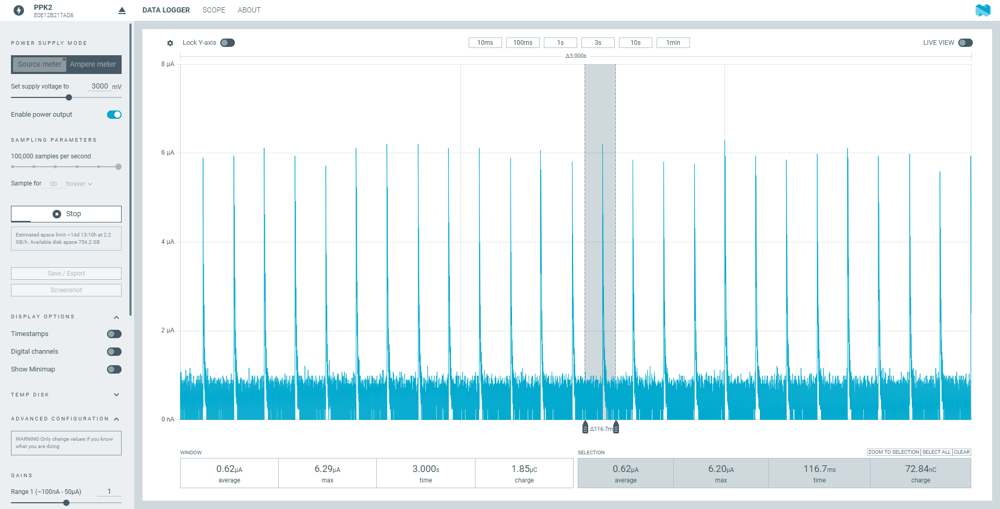
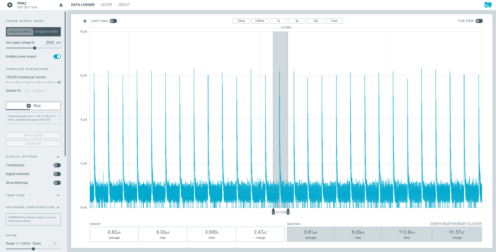
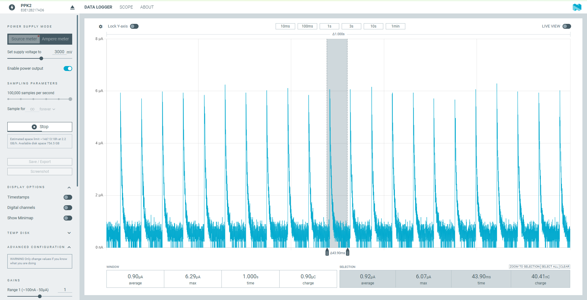
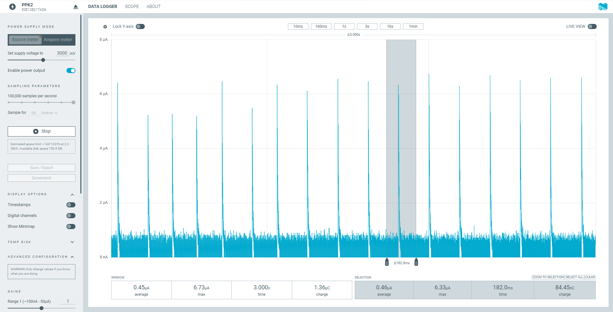
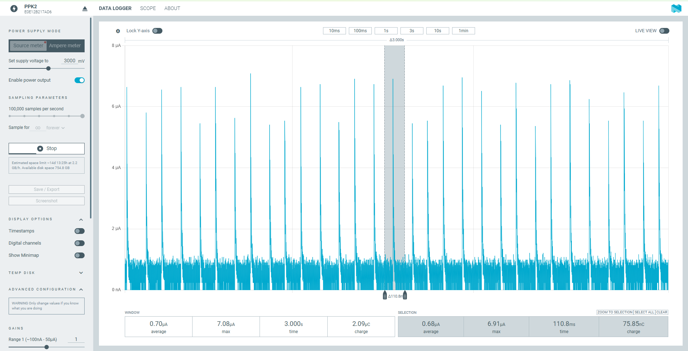
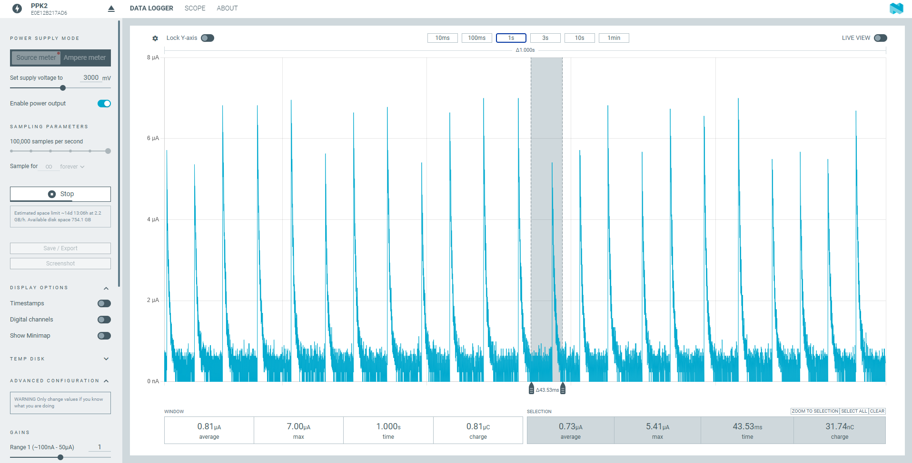
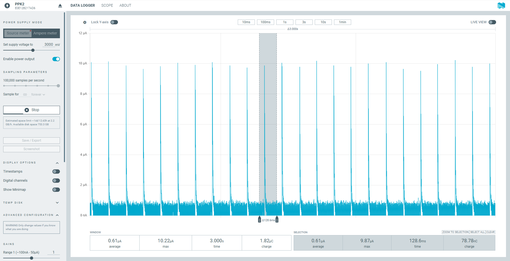
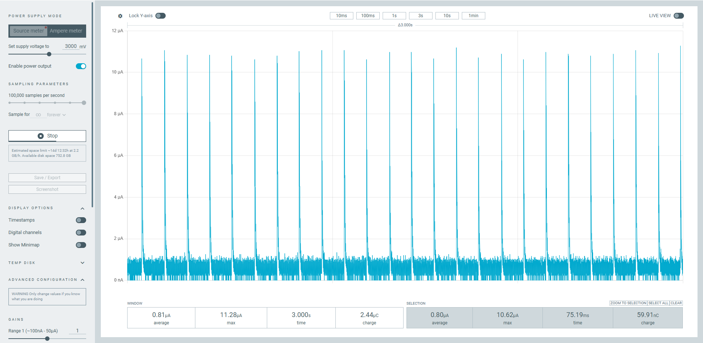
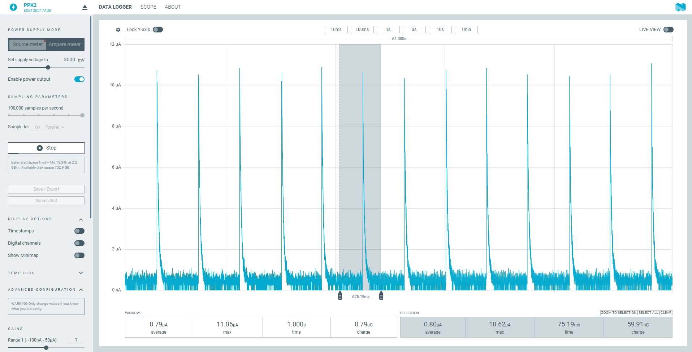

# System OFF Power Measurements — nRF54L15 DK / nRF54LM20 DK / nRF54LS05 DK

[中文](power_results.md)

Updated: 2026-10-30

## 1. Test conditions

| Item | Details |
|---|---|
| Boards | nRF54L15 DK v1.0.0 (PCA10156), SoC **nRF54L15 Rev 2**, target `nrf54l15dk/nrf54l15/cpuapp`; nRF54LM20 DK v0.7.0 (PCA10184), SoC **nRF54LM20B Engineering B (ENGB)**, target `nrf54lm20dk/nrf54lm20b/cpuapp`; nRF54LS05 DK v0.3.1 (PCA10214), SoC **nRF54LS05B Rev 1**, target `nrf54ls05dk/nrf54ls05b/cpuapp` |
| SDK | NCS v3.4.1 (sysbuild) |
| Firmware | This sample (`system_off`), which enters System OFF on every boot; `CONFIG_PM_DEVICE` and `PM_DEVICE_RUNTIME` on; DC/DC on; low-frequency clock is the LFXO |
| Modes | `pin`: sw0 wake-up, GRTC and the low-frequency clock are stopped before System OFF, no RAM retained. `grtc`: GRTC wake-up after 10 s, no RAM retained. `ret`: sw0 wake-up, 4 KB `retained_mem` retained (`-S pinwake -S retram`) |
| Supply | PPK2 in source meter mode, **3.0 V**, 100,000 samples per second |
| Instrument | Nordic Power Profiler app (PPK2); the window of each plot is listed in section 3 |
| Not recorded | The screenshots do not record whether the log and SWD were on or off; the ambient temperature was not recorded |

## 2. Datasheet values

Conditions: VDD = 3 V, 25 °C, DC/DC, reference circuit. "RAM" in System OFF means the amount of retained RAM.

| Device | Symbol | Condition | Typical |
|---|---|---|---|
| nRF54L15 / L10 / L05 | IOFF0 | System OFF, wake on pin, 0 KB RAM retained | 0.7 µA |
| nRF54L15 / L10 / L05 | IOFF1 | System OFF, wake on pin + GRTC (LFXO), 0 KB RAM retained | 0.9 µA |
| nRF54LM20A / B | IOFF0 | System OFF, wake on pin, 0 KB RAM retained | 0.7 µA |
| nRF54LM20A / B | IOFF1 | System OFF, wake on pin + GRTC (LFXO), 0 KB RAM retained | 1.0 µA |
| nRF54LS05A / B | IOFF0 | System OFF, wake on pin, 0 KB RAM retained | 0.6 µA (marked as estimated in the datasheet) |
| nRF54LS05A / B | IOFF1 | System OFF, wake on pin + GRTC (LFXO), 0 KB RAM retained | 0.7 µA (marked as estimated in the datasheet) |

- The datasheet gives System OFF for these two conditions only. There is no entry with retained RAM, and no values by temperature or voltage.
- In this sample `pin` corresponds to IOFF0 and `grtc` (LFXO) to IOFF1; `ret` (4 KB retained) has no datasheet entry.
- Erratum 37 (L15 Engineering B, Revision 1, Revision 2): entering System OFF too soon after a pin reset or power-up gives a higher current. `SystemInit()` in NCS v3.4.1 already contains the workaround, so a build with NCS needs nothing extra.

## 3. Results

Average current in µA, taken from the window of each plot. Window length: 3 s for `pin` and `grtc`, 1 s for `ret`. The figure number is in brackets.

| Mode | nRF54L15 | nRF54LM20B | nRF54LS05B |
|---|---|---|---|
| `pin` (sw0 wake-up, 0 KB RAM) | **0.62** (Figure 1) | **0.61** (Figure 7) | **0.45** (Figure 4) |
| `grtc` (GRTC wake-up after 10 s, 0 KB RAM) | **0.82** (Figure 2) | **0.81** (Figure 8) | **0.70** (Figure 5) |
| `ret` (sw0 wake-up, 4 KB retained) | **0.90** (Figure 3) | **0.79** (Figure 9) | **0.81** (Figure 6) |

## 4. Plots

### 4.1 nRF54L15



*Figure 1: nRF54L15 DK, `pin`, 3.0 V. 3 s window: average 0.62 µA, maximum 6.29 µA, charge 1.85 µC. Selected cycle (116.7 ms): average 0.62 µA, maximum 6.20 µA. A ~6 µA spike about every 117 ms.*



*Figure 2: nRF54L15 DK, `grtc`, 3.0 V. 3 s window: average 0.82 µA, maximum 6.33 µA, charge 2.47 µC. Selected cycle (112.8 ms): average 0.81 µA, maximum 6.20 µA. A ~6 µA spike about every 110 ms.*



*Figure 3: nRF54L15 DK, `ret`, 3.0 V. 1 s window: average 0.90 µA, maximum 6.29 µA, charge 0.90 µC. Selected cycle (43.9 ms): average 0.92 µA. A ~6 µA spike about every 45 ms.*

### 4.2 nRF54LS05B



*Figure 4: nRF54LS05B DK, `pin`, 3.0 V. 3 s window: average 0.45 µA, maximum 6.73 µA, charge 1.36 µC. Selected cycle (182.0 ms): average 0.46 µA, maximum 6.33 µA. A ~6 µA spike about every 182 ms.*



*Figure 5: nRF54LS05B DK, `grtc`, 3.0 V. 3 s window: average 0.70 µA, maximum 7.08 µA, charge 2.09 µC. Selected cycle (110.8 ms): average 0.68 µA, maximum 6.91 µA. A ~6 µA spike about every 110 ms.*



*Figure 6: nRF54LS05B DK, `ret`, 3.0 V. 1 s window: average 0.81 µA, maximum 7.00 µA, charge 0.81 µC. Selected cycle (43.53 ms): average 0.73 µA, maximum 5.41 µA. A ~6 µA spike about every 44 ms.*

### 4.3 nRF54LM20B



*Figure 7: nRF54LM20B DK, `pin`, 3.0 V. 3 s window: average 0.61 µA, maximum 10.22 µA, charge 1.82 µC. Selected cycle (128.6 ms): average 0.61 µA, maximum 9.87 µA, charge 78.78 nC. A ~10 µA spike about every 129 ms.*



*Figure 8: nRF54LM20B DK, `grtc`, 3.0 V. 3 s window: average 0.81 µA, maximum 11.28 µA, charge 2.44 µC. A ~11 µA spike about every 120 ms.*



*Figure 9: nRF54LM20B DK, `ret`, 3.0 V. 1 s window: average 0.79 µA, maximum 11.06 µA, charge 0.79 µC. Selected cycle (75.19 ms): average 0.80 µA, maximum 10.62 µA, charge 59.91 nC. A ~11 µA spike about every 75 ms.*

## 5. The third RAM section of nRF54LS05B

The LS05B has 96 KB (3 sections of 32 KB), but the nrfx RAM table lists only 2 sections for nRF54LS05, so `sys_poweroff()` clears only bits 0 and 1 of `POWER[0].RET`. The retention of the third section (`0x20010000–0x20017FFF`) stays on. `extra_ram_off()` in `main.c` also clears bit 2 when `APP_USE_RETAINED_MEM` is off.

## 6. Reproduce

```
west build -b <board> --sysbuild -S pinwake            -- -DSNIPPET_ROOT=<sample dir>   # pin
west build -b <board> --sysbuild -S grtcwake           -- -DSNIPPET_ROOT=<sample dir>   # grtc
west build -b <board> --sysbuild -S pinwake -S retram  -- -DSNIPPET_ROOT=<sample dir>   # ret
```

Build each configuration once with `-p` (pristine) so that an old CMake cache does not carry in an old configuration.
