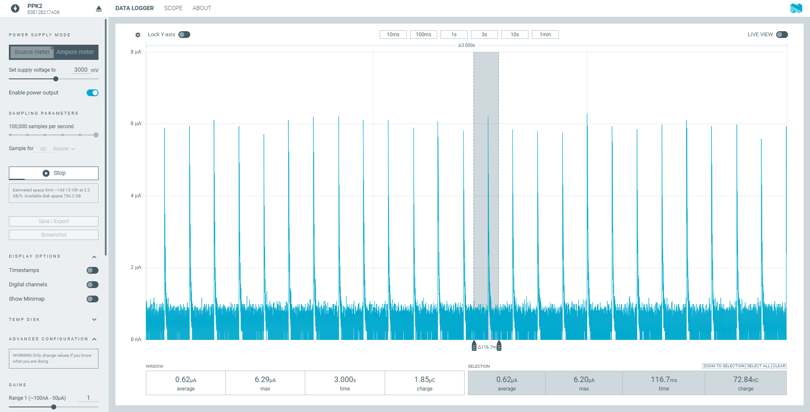
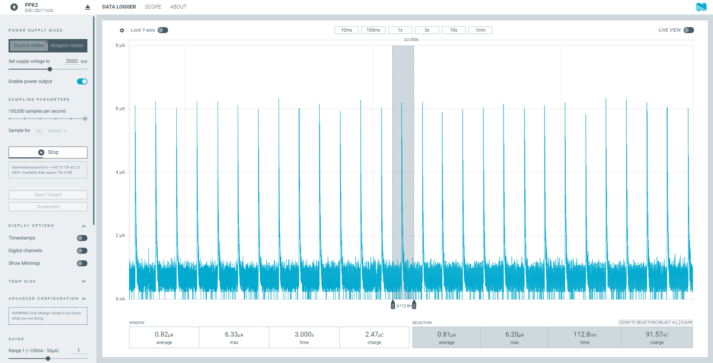
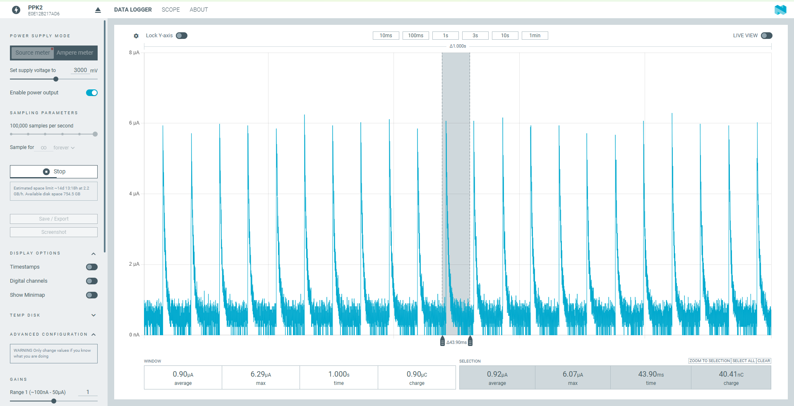
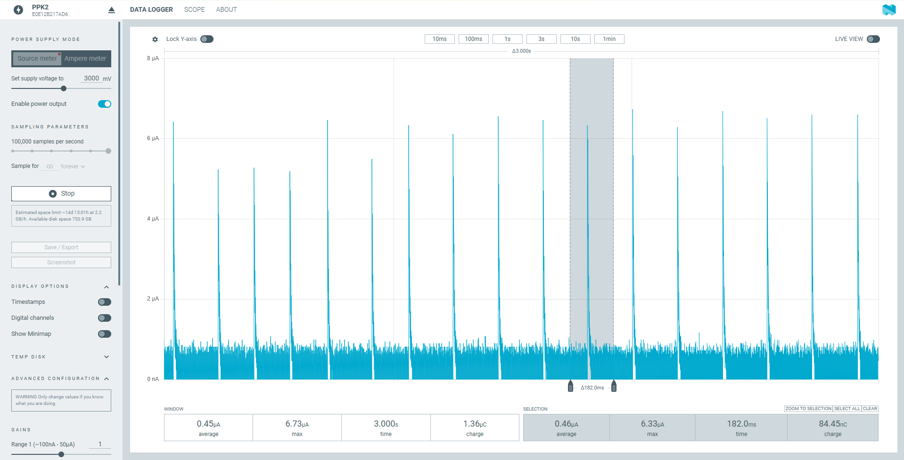
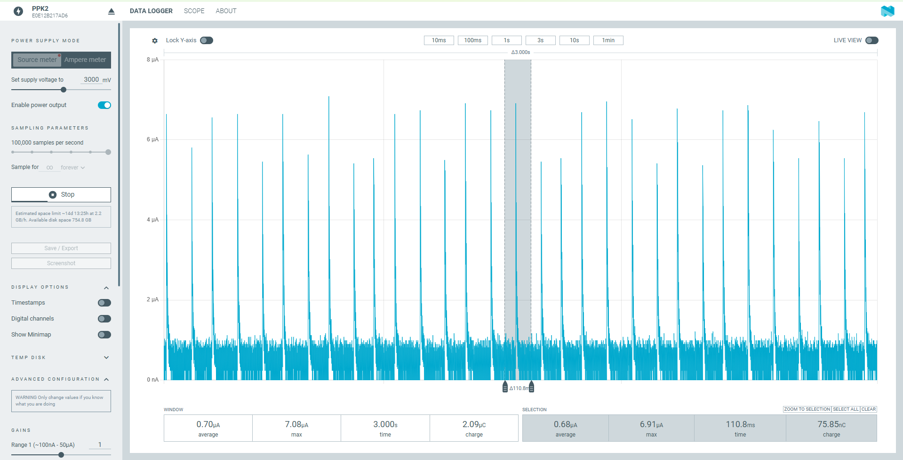
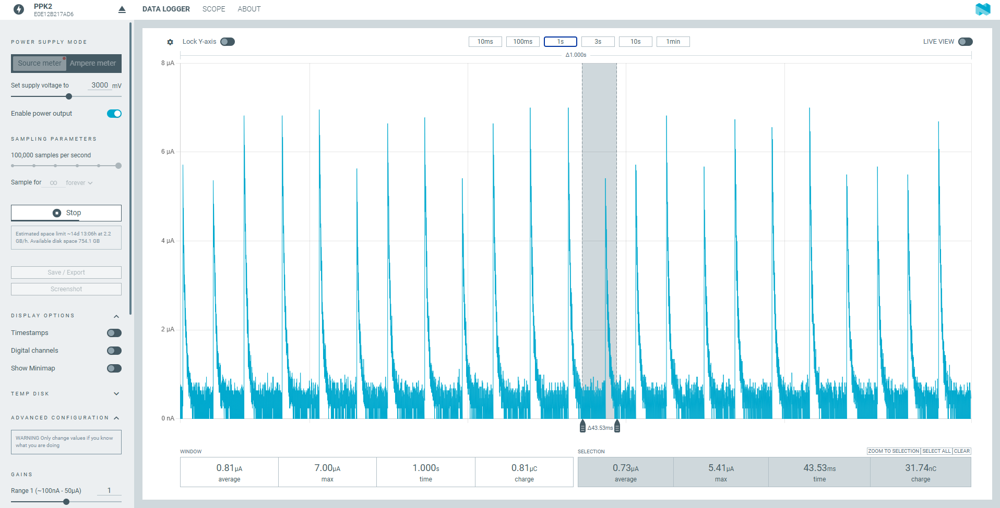
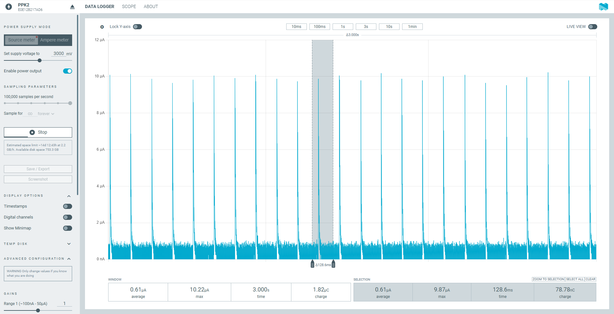
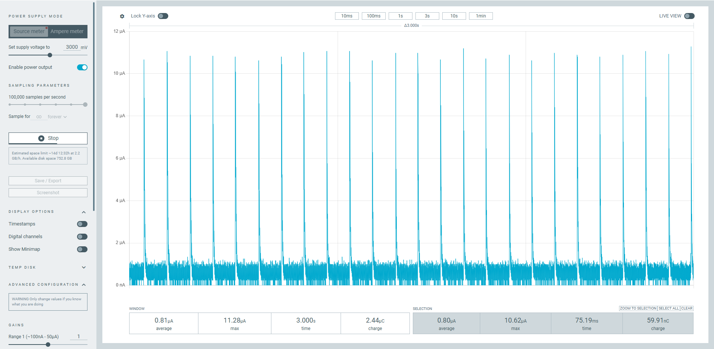
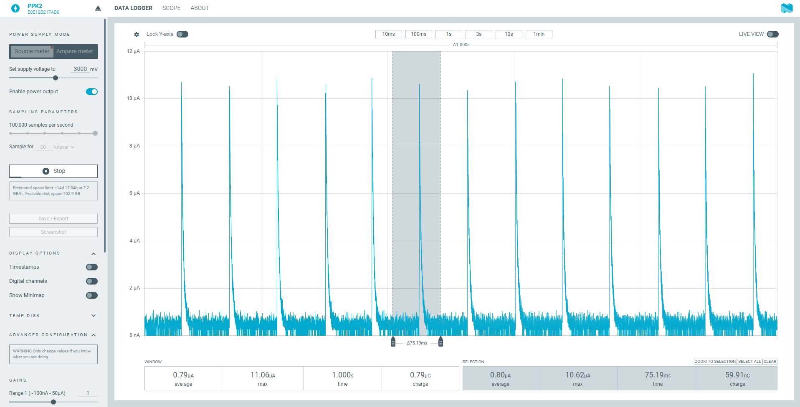

# System OFF 功耗测试记录 — nRF54L15 DK / nRF54LM20 DK / nRF54LS05 DK

[English](power_results.en.md)

更新日期:2026-10-30

## 1. 测试条件

| 项目 | 内容 |
|---|---|
| 板子 | nRF54L15 DK v1.0.0(PCA10156),SoC **nRF54L15 Rev 2**,目标 `nrf54l15dk/nrf54l15/cpuapp`;nRF54LM20 DK v0.7.0(PCA10184),SoC **nRF54LM20B Engineering B(ENGB)**,目标 `nrf54lm20dk/nrf54lm20b/cpuapp`;nRF54LS05 DK v0.3.1(PCA10214),SoC **nRF54LS05B Rev 1**,目标 `nrf54ls05dk/nrf54ls05b/cpuapp` |
| SDK | NCS v3.4.1(sysbuild) |
| 固件 | 本 sample(`system_off`),每次启动都进入 System OFF;`CONFIG_PM_DEVICE`、`PM_DEVICE_RUNTIME` 开启;DC/DC 开启;低频时钟 LFXO |
| 模式 | `pin`:sw0 唤醒,进入前关 GRTC 和低频时钟,不保持 RAM。`grtc`:GRTC 10 s 唤醒,不保持 RAM。`ret`:sw0 唤醒,保持 4 KB `retained_mem`(`-S pinwake -S retram`) |
| 供电 | PPK2 源表模式,**3.0 V**,100 000 样点/秒 |
| 仪表 | Nordic Power Profiler 应用(PPK2);每张图的窗口见第 3 节 |
| 没有记录的条件 | 截图里没有记录日志和 SWD 的开关状态;环境温度没有记录 |

## 2. 规格书数据

条件:VDD = 3 V,25 °C,DC/DC,参考电路。System OFF 下 "RAM" 指保持的 RAM 量。

| 芯片 | 符号 | 条件 | 典型值 |
|---|---|---|---|
| nRF54L15 / L10 / L05 | IOFF0 | System OFF,引脚唤醒,保持 0 KB RAM | 0.7 µA |
| nRF54L15 / L10 / L05 | IOFF1 | System OFF,引脚 + GRTC(LFXO)唤醒,保持 0 KB RAM | 0.9 µA |
| nRF54LM20A / B | IOFF0 | System OFF,引脚唤醒,保持 0 KB RAM | 0.7 µA |
| nRF54LM20A / B | IOFF1 | System OFF,引脚 + GRTC(LFXO)唤醒,保持 0 KB RAM | 1.0 µA |
| nRF54LS05A / B | IOFF0 | System OFF,引脚唤醒,保持 0 KB RAM | 0.6 µA(规格书标注为估计值) |
| nRF54LS05A / B | IOFF1 | System OFF,引脚 + GRTC(LFXO)唤醒,保持 0 KB RAM | 0.7 µA(规格书标注为估计值) |

- 规格书里 System OFF 只给了这两个条件,没有保持 RAM 的条目,也没有按温度或电压分档的数值。
- 本 sample 的 `pin` 对应 IOFF0,`grtc`(LFXO)对应 IOFF1;`ret`(保持 4 KB)在规格书里没有对应条目。
- 勘误 37(L15 Engineering B、Revision 1、Revision 2):引脚复位或上电后太快进入 System OFF,电流会偏高。NCS v3.4.1 的 `SystemInit()` 已经实现规避,用 NCS 编译不需要手动加。

## 3. 测试结果

平均电流,单位 µA,取每张图的窗口平均值。窗口长度:`pin`、`grtc` 是 3 s,`ret` 是 1 s。括号里是图号。

| 模式 | nRF54L15 | nRF54LM20B | nRF54LS05B |
|---|---|---|---|
| `pin`(sw0 唤醒,0 KB RAM) | **0.62**(图 1) | **0.61**(图 7) | **0.45**(图 4) |
| `grtc`(GRTC 10 s 唤醒,0 KB RAM) | **0.82**(图 2) | **0.81**(图 8) | **0.70**(图 5) |
| `ret`(sw0 唤醒,保持 4 KB) | **0.90**(图 3) | **0.79**(图 9) | **0.81**(图 6) |

## 4. 波形

### 4.1 nRF54L15



*图 1:nRF54L15 DK,`pin`,3.0 V。3 s 窗口平均 0.62 µA,最大 6.29 µA,电荷 1.85 µC;选中的一个周期(116.7 ms)平均 0.62 µA,最大 6.20 µA。每约 117 ms 一个 ~6 µA 尖峰。*



*图 2:nRF54L15 DK,`grtc`,3.0 V。3 s 窗口平均 0.82 µA,最大 6.33 µA,电荷 2.47 µC;选中的一个周期(112.8 ms)平均 0.81 µA,最大 6.20 µA。每约 110 ms 一个 ~6 µA 尖峰。*



*图 3:nRF54L15 DK,`ret`,3.0 V。1 s 窗口平均 0.90 µA,最大 6.29 µA,电荷 0.90 µC;选中的一个周期(43.9 ms)平均 0.92 µA。每约 45 ms 一个 ~6 µA 尖峰。*

### 4.2 nRF54LS05B



*图 4:nRF54LS05B DK,`pin`,3.0 V。3 s 窗口平均 0.45 µA,最大 6.73 µA,电荷 1.36 µC;选中的一个周期(182.0 ms)平均 0.46 µA,最大 6.33 µA。每约 182 ms 一个 ~6 µA 尖峰。*



*图 5:nRF54LS05B DK,`grtc`,3.0 V。3 s 窗口平均 0.70 µA,最大 7.08 µA,电荷 2.09 µC;选中的一个周期(110.8 ms)平均 0.68 µA,最大 6.91 µA。每约 110 ms 一个 ~6 µA 尖峰。*



*图 6:nRF54LS05B DK,`ret`,3.0 V。1 s 窗口平均 0.81 µA,最大 7.00 µA,电荷 0.81 µC;选中的一个周期(43.53 ms)平均 0.73 µA,最大 5.41 µA。每约 44 ms 一个 ~6 µA 尖峰。*

### 4.3 nRF54LM20B



*图 7:nRF54LM20B DK,`pin`,3.0 V。3 s 窗口平均 0.61 µA,最大 10.22 µA,电荷 1.82 µC;选中的一个周期(128.6 ms)平均 0.61 µA,最大 9.87 µA,电荷 78.78 nC。每约 129 ms 一个 ~10 µA 尖峰。*



*图 8:nRF54LM20B DK,`grtc`,3.0 V。3 s 窗口平均 0.81 µA,最大 11.28 µA,电荷 2.44 µC。每约 120 ms 一个 ~11 µA 尖峰。*



*图 9:nRF54LM20B DK,`ret`,3.0 V。1 s 窗口平均 0.79 µA,最大 11.06 µA,电荷 0.79 µC;选中的一个周期(75.19 ms)平均 0.80 µA,最大 10.62 µA,电荷 59.91 nC。每约 75 ms 一个 ~11 µA 尖峰。*

## 5. nRF54LS05B 的第三段 RAM

LS05B 有 96 KB(3 段 × 32 KB),但 nrfx 的 RAM 表里 nRF54LS05 只有 2 段,`sys_poweroff()` 只清了 `POWER[0].RET` 的 bit 0、1,第三段(`0x20010000–0x20017FFF`)的保持一直开着。`main.c` 的 `extra_ram_off()` 在不开 `APP_USE_RETAINED_MEM` 时再清 bit 2。

## 6. 复现

```
west build -b <board> --sysbuild -S pinwake            -- -DSNIPPET_ROOT=<sample 目录>   # pin
west build -b <board> --sysbuild -S grtcwake           -- -DSNIPPET_ROOT=<sample 目录>   # grtc
west build -b <board> --sysbuild -S pinwake -S retram  -- -DSNIPPET_ROOT=<sample 目录>   # ret
```

每个配置先用 `-p`(pristine)构建一次,避免旧的 CMake 缓存带进旧配置。
