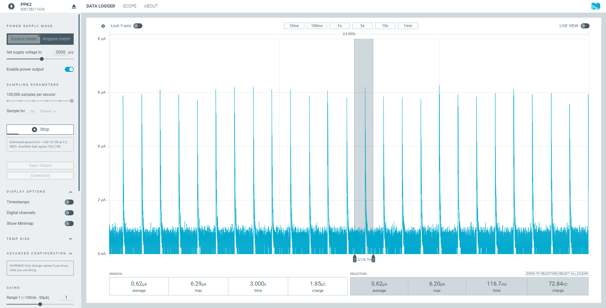
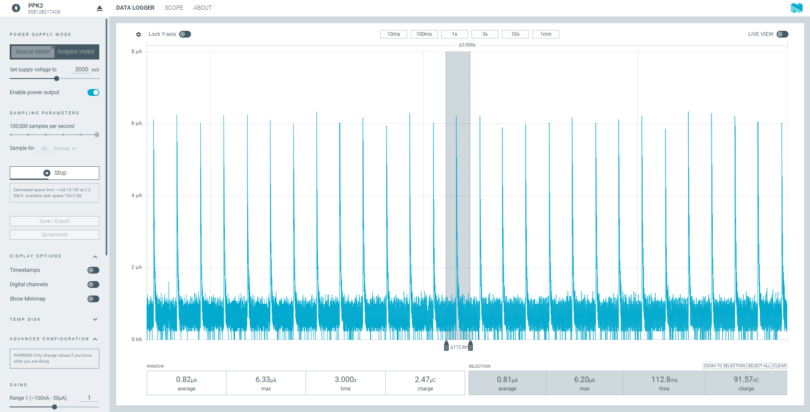
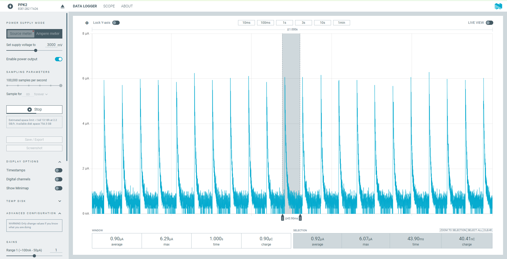
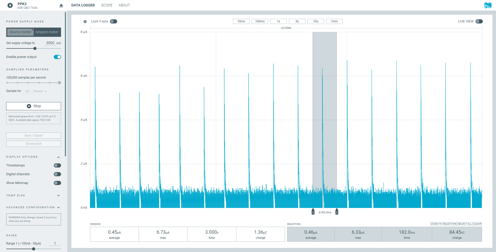
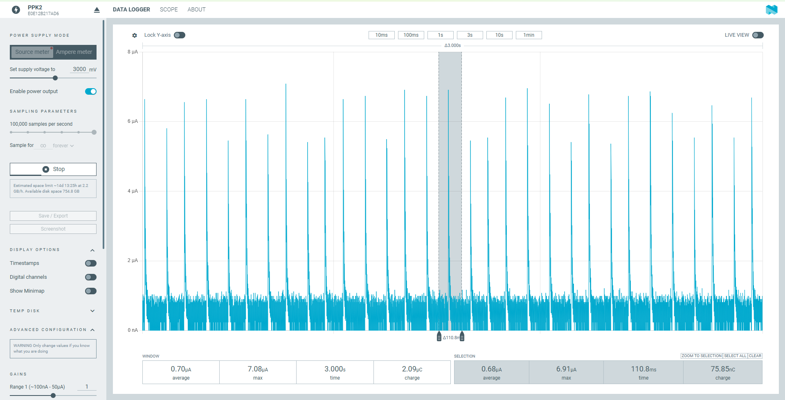
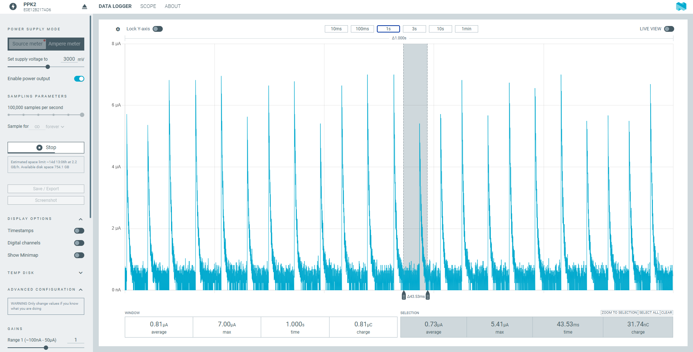
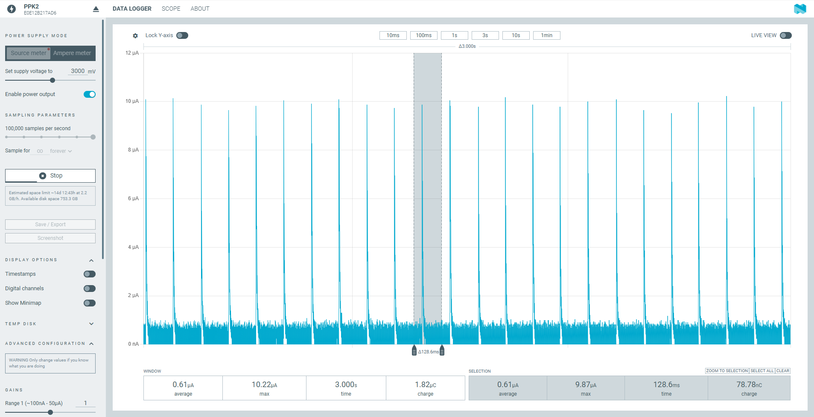
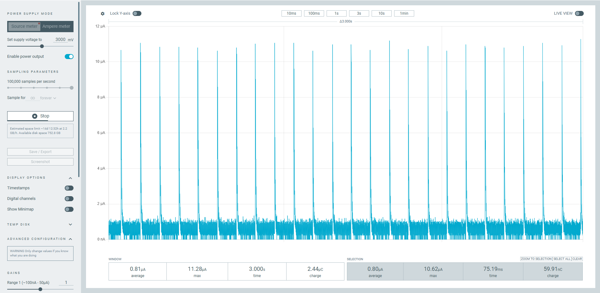
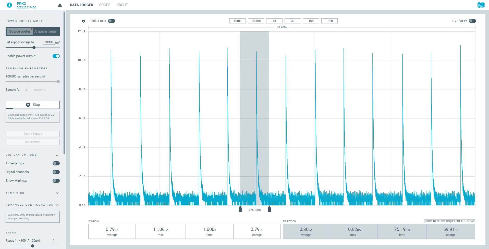

# system_off — a sample that enters System OFF at power-up

Verifies that the nRF54L15 DK, nRF54LM20 DK and nRF54LS05 DK all enter System OFF after boot, and measures the System OFF current with different wake-up sources and RAM retention configurations.

- SDK: nRF Connect SDK v3.4.1 (sysbuild)
- Target boards: `nrf54l15dk/nrf54l15/cpuapp`, `nrf54lm20dk/nrf54lm20a/cpuapp`, `nrf54lm20dk/nrf54lm20b/cpuapp`, `nrf54ls05dk/nrf54ls05a/cpuapp`, `nrf54ls05dk/nrf54ls05b/cpuapp`
- Low-frequency clock: LFXO is always used

## What the application does

`main()` performs these steps in order:

1. Prints `system_off sample started`.
2. `report_boot()`: prints the reset cause (print only, not used for any decision). If `CONFIG_APP_USE_RETAINED_MEM` is enabled, it validates the data in retained RAM, increments `boots` and `off_count`, and writes them back.
3. `prepare_wakeup()`: enables wake-up sources according to Kconfig.
   - `CONFIG_APP_GRTC_WAKEUP_ENABLE`: `z_nrf_grtc_wakeup_prepare()`, wakes up after `CONFIG_APP_GRTC_WAKEUP_SECONDS` seconds (default 10 s).
   - `CONFIG_APP_GPIO_WAKEUP_ENABLE`: configures `sw0` as an input with a level-triggered interrupt. It first waits for the button to be released, so the device is not woken immediately after entering System OFF. If the button is still held after `CONFIG_APP_GPIO_RELEASE_TIMEOUT_MS` (default 5000 ms), it prints a `LOG_WRN` and gives up the sw0 wake-up instead of blocking forever.
   - GRTC is armed last. After `z_nrf_grtc_wakeup_prepare()` the code goes straight into System OFF without printing any more logs.
4. Enters System OFF with `sys_poweroff()`. Before the call, it clears the retention of the blocks in `MEMCONF POWER[1].RET` that `sys_poweroff()` does not handle (ICACHE, CRACEN, USBHS).

## Configuration

There are three dimensions:

| Dimension | Option | How to choose |
|---|---|---|
| Logging | on (default) / off (release) | For release add `-DFILE_SUFFIX=release`, which uses `prj_release.conf` and `app_release.overlay` (`uart20` disabled; logging, serial and HWINFO off) |
| Mode | `pin` / `grtc` / `ret` | See the table below |
| Board | L15 / LM20A / LM20B / LS05A / LS05B | `west build -b ...` or `setup` in the dev shell |

| Mode | Wake-up | RAM | Build options | Boards |
|---|---|---|---|---|
| `pin` | sw0 | GRTC and the low-frequency clock are shut down before entering | `-S pinwake`, equivalent to `-DCONFIG_APP_GPIO_WAKEUP_ENABLE=y` | All |
| `grtc` | GRTC, 10 s | POWER[1] retention cleared | `-S grtcwake`, equivalent to `-DCONFIG_APP_GRTC_WAKEUP_ENABLE=y` | All |
| `ret` | sw0 | 4 KB retained; GRTC and the low-frequency clock are shut down | `-S pinwake -S retram`, equivalent to `-DCONFIG_APP_GPIO_WAKEUP_ENABLE=y -DCONFIG_APP_USE_RETAINED_MEM=y -DEXTRA_DTC_OVERLAY_FILE=snippets/retram/<soc>.overlay` (`retram` picks the overlay per board automatically) | Builds on all 5 boards |

Both `prj.conf` and `prj_release.conf` enable `CONFIG_PM_DEVICE`, `CONFIG_PM_DEVICE_RUNTIME` and `CONFIG_POWEROFF`, and turn off the deprecated `CONFIG_NRF_PLATFORM_LUMOS`. The release configuration additionally disables `CONFIG_UART_CONSOLE`.

Select the mode with snippets: `west build --sysbuild -b <board> -S pinwake|grtcwake|retram -- -DSNIPPET_ROOT=<this directory>` (defined in `snippets/`). The default configuration without any snippet has no wake-up source (the device can only restart through a reset or a power cycle), retains no RAM, and shuts down GRTC and the low-frequency clock before entering System OFF. Snippets can be combined, e.g. `-S pinwake -S retram`. With sysbuild, `SNIPPET_ROOT` must be given explicitly, otherwise sysbuild cannot find the local snippets. Snippets are applied to all images.

### Kconfig

| Symbol | Description |
|---|---|
| `APP_USE_RETAINED_MEM` | Requires a `retainedmemdevice` alias in the devicetree (provided by `snippets/retram/<soc>.overlay`); automatically selects `RETAINED_MEM` and `CRC` |
| `APP_GRTC_WAKEUP_ENABLE`, `APP_GRTC_WAKEUP_SECONDS` | GRTC wake-up and its timeout (default 10 s) |
| `APP_GPIO_WAKEUP_ENABLE` | Requires the `sw0` alias; automatically selects `GPIO`; off by default, turned on by the `pinwake` snippet |
| `APP_GPIO_RELEASE_TIMEOUT_MS` | Timeout for waiting for sw0 to be released (default 5000 ms); after the timeout the sw0 wake-up is not installed and the device goes straight into System OFF |
| `APP_SYS_CLOCK_DISABLE` | Calls `sys_clock_disable()` before entering System OFF to shut down GRTC and the low-frequency clock; default `y`; cannot be enabled together with `APP_GRTC_WAKEUP_ENABLE` |

Note: with logging enabled, the asynchronous suspend work of the UART runtime PM must be allowed to finish before `sys_clock_disable()` (the `k_msleep(100)` in `main.c`). Otherwise, once the system clock has stopped, the scheduler keeps reading the stopped GRTC counter in `sys_clock_elapsed()` and the CPU spins at full speed.

Before every entry into System OFF, the bits in `MEMCONF POWER[1].RET` that `sys_poweroff()` does not handle are cleared (`sys_cache_instr_disable()` is called before clearing ICACHE, since the datasheet requires the cache to be disabled when its block is powered off). Bit n of `POWER[1].RET` corresponds to block 32+n, and all bits reset to 1 (retained). Per chip:

| Bit | Block | nRF54L15 / L10 / L05 | nRF54LM20A/B | nRF54LS05A/B |
|---|---|---|---|---|
| bit0 | 32 | VPR sleep RAM (already cleared by sys_poweroff()) | same | same |
| bit1 | 33 | ICACHE tag + data | ICACHE | ICACHE |
| bit2 | 34 | CRACEN PKE code RAM | USBHS RAM | not listed in the documentation |
| bit3 | 35 | CRACEN KeyRAM | not listed in the documentation | not listed in the documentation |

### Devicetree

The overlays have three layers:

- `boards/dk_common.overlay`: common to all DKs. Removes the LEDs, PWM LEDs and related aliases, disables `pwm20`, and suspends `uart20` at boot. By default it deletes the `buttons` node (all buttons) and the `sw0` alias; the `pinwake` snippet then rebuilds `button0` inside `buttons` and `sw0 = &button0` per chip (`snippets/pinwake/<soc>.overlay`) as the GPIO wake-up pin. `button0` is on P1.13 on L15 and LS05, and on P1.26 on LM20 (`pinwake.conf` also turns on `APP_GPIO_WAKEUP_ENABLE`; the Kconfig depends on the `sw0` alias being available).
- `boards/dk_l15_lm20_common.overlay`: nRF54L15 and nRF54LM20 only. Removes `button1~3` and the on-board SPI flash (`mx25r64`), disables `spi00`, and converts the NFC pins to GPIO. nRF54LS05 does not have these nodes, so this layer cannot be used there.
- `boards/<board>.overlay`: keeps only the TX pin of `uart20` (P1.04 on L15, P1.16 on LM20, P1.10 on LS05). The a/b variants of LM20 share `nrf54lm20dk_common.overlay`, and the a/b variants of LS05 share `nrf54ls05dk_common.overlay`.

The 4 KB retained RAM is **not part of the default build** (on L15 the location differs from `zephyr/samples/boards/nordic/system_off`: upstream places it at `0x2002e000` and leaves the following 68 KB to FLPR, whereas this sample does not use FLPR and puts it at the end of the 256 KB). This way, in the default build cpuapp gets all of the RAM (L15 256 KB, LS05A 64 KB, LS05B 96 KB, LM20 511 KB). The retained region lives in a separate `snippets/retram/<soc>.overlay`, which the `retram` snippet adds per board (the dev shell's `ret` uses it automatically):

| File | Board | Retained region | cpuapp SRAM |
|---|---|---|---|
| `snippets/retram/nrf54l15.overlay` | L15 | `0x2003f000` | 256 KB reduced to 252 KB |
| `snippets/retram/nrf54lm20.overlay` | LM20A / LM20B | `0x2007ec00` | reduced to 507 KB |
| `snippets/retram/nrf54ls05a.overlay` | LS05A (64 KB RAM) | `0x2000f000` | 64 KB reduced to 60 KB |
| `snippets/retram/nrf54ls05b.overlay` | LS05B (96 KB RAM) | `0x20017000` | 96 KB reduced to 92 KB |

`boards/<board>_release.overlay` additionally includes `app_release.overlay` on top of the above, which disables `uart20`.

### RAM retention

`sys_poweroff()` first turns off retention of all RAM, and then, based on the `retained_mem` driver, restores retention for the `zephyr,retained-ram` region in the devicetree. Therefore:

- Without `APP_USE_RETAINED_MEM`: no RAM is retained (the 0 KB condition of the datasheet).
- With `APP_USE_RETAINED_MEM`: these 4 KB are retained and `src/retained.c` validates them with a CRC. On a cold power-up the RAM contents are invalid and get reset, and the log shows `INVALID`; after waking from System OFF it shows `valid` and `boots` increments.

PPK2 screenshot of `pin` mode (sw0 wake-up) on the nRF54L15 DK: Source 3.0 V, 100 kHz, 3 s window average 0.62 µA.



PPK2 screenshot of `grtc` mode (GRTC wake-up) on the nRF54L15 DK: Source 3.0 V, 100 kHz, 3 s window average 0.82 µA.



PPK2 screenshot of `ret` mode (4 KB retained_mem retained; on L15 a 32 KB RAM section is actually retained) on the nRF54L15 DK: Source 3.0 V, 100 kHz, 1 s window average 0.90 µA.



PPK2 screenshot of `pin` mode (sw0 wake-up) on the nRF54LS05B DK: Source 3.0 V, 100 kHz, 3 s window average 0.45 µA.



PPK2 screenshot of `grtc` mode (GRTC 10 s wake-up) on the nRF54LS05B DK: Source 3.0 V, 100 kHz, 3 s window average 0.70 µA.



PPK2 screenshot of `ret` mode (sw0 wake-up, 4 KB retained_mem in the third 32 KB section) on the nRF54LS05B DK: Source 3.0 V, 100 kHz, 1 s window average 0.81 µA.



PPK2 screenshot of `pin` mode (sw0 wake-up) on the nRF54LM20B DK: Source 3.0 V, 100 kHz, 3 s window average 0.61 µA.



PPK2 screenshot of `grtc` mode (GRTC 10 s wake-up) on the nRF54LM20B DK: Source 3.0 V, 100 kHz, 3 s window average 0.81 µA.



PPK2 screenshot of `ret` mode (4 KB retained_mem retained) on the nRF54LM20B DK: Source 3.0 V, 100 kHz, 1 s window average 0.79 µA.



**Third RAM section on LS05B:** LS05B has 96 KB (3 sections × 32 KB), but the nrfx RAM table for nRF54LS05 has only 2 sections, so `sys_poweroff()` only clears bits 0 and 1 of `POWER[0].RET` (read as `0xffffffff` before turning retention off and `0xfffffffc` after). Retention of the third section (`0x20010000–0x20017FFF`) therefore stays on. LS05A has only 64 KB (2 sections) and is not affected. In `extra_ram_off()` in `main.c`, for LS05B without `APP_USE_RETAINED_MEM`, bit 2 is additionally cleared.

`src/retained.c` and `src/retained.h` are copied from the original example and keep their original Apache-2.0 license header.

## System OFF current in the datasheets

Conditions: VDD = 3 V, 25 °C, DC/DC, reference circuit. In System OFF, "RAM" means the amount of RAM retained.

| Chip | Symbol | Condition | Typical |
|---|---|---|---|
| nRF54L15 / L10 / L05 | IOFF0 | System OFF, pin wake-up, 0 KB RAM retained | 0.7 µA |
| nRF54L15 / L10 / L05 | IOFF1 | System OFF, pin + GRTC (LFXO) wake-up, 0 KB RAM retained | 0.9 µA |
| nRF54LM20A / B | IOFF0 | System OFF, pin wake-up, 0 KB RAM retained | 0.7 µA |
| nRF54LM20A / B | IOFF1 | System OFF, pin + GRTC (LFXO) wake-up, 0 KB RAM retained | 1.0 µA |
| nRF54LS05A / B | IOFF0 | System OFF, pin wake-up, 0 KB RAM retained | 0.6 µA (marked as an estimate in the datasheet) |
| nRF54LS05A / B | IOFF1 | System OFF, pin + GRTC (LFXO) wake-up, 0 KB RAM retained | 0.7 µA (marked as an estimate in the datasheet) |

- Erratum [37] (L15 Engineering B, Revision 1, Revision 2): entering System OFF too soon after a pin reset or power-up gives a higher current. The workaround is already implemented in `SystemInit()` of NCS v3.4.1, so no manual change is needed when building with NCS.

## Building

```
west build -b nrf54l15dk/nrf54l15/cpuapp --sysbuild -S grtcwake -- -DSNIPPET_ROOT=<this directory>
west build -b nrf54lm20dk/nrf54lm20a/cpuapp --sysbuild -S pinwake -S retram -- -DSNIPPET_ROOT=<this directory>
west build -b nrf54lm20dk/nrf54lm20b/cpuapp --sysbuild -S pinwake -S retram -- -DSNIPPET_ROOT=<this directory> -DFILE_SUFFIX=release
west build -b nrf54ls05dk/nrf54ls05b/cpuapp --sysbuild -- -DFILE_SUFFIX=release
```

## Dev shell

Double-click `dev.cmd` (or run `. .\dev.ps1`) to open PowerShell with `setup`, `build`, `rebuild`, `flash`, `recover` and `clean`:

```
setup                                  # check NCS, then pick board / mode / logging
setup -Board lm20a -Mode grtc -Log off # or pass the arguments directly
rebuild                                # west build -p --sysbuild, output to build\<board>_<mode>[_log]
flash                                  # flash the selected configuration (no rebuild, no mass erase)
recover                                # recover the DK (nrfutil device recover), asks for confirmation first
```

`-Board`: `l15`, `lm20a`, `lm20b`, `ls05a`, `ls05b`; `-Mode`: `pin`, `grtc`, `ret`; `-Log`: `on`, `off`.

`recover` erases all flash and UICR on the chip and removes access port protection; firmware and data are lost. Use it when the board cannot be flashed or connected. You must type `y` to confirm before it runs (`-Force` skips the confirmation). If there is only one J-Link device it is selected automatically; with several, you are asked for the serial number (or pass `-DevId <serial>`). After recovery, use `flash` to program the firmware again.

## Testing (twister)

`sample.yaml` has 6 scenarios, named `sample.system_off.log.<pin|grtc|ret>` (with logging) and `sample.system_off.<pin|grtc|ret>` (release). They select the mode with `required_snippets` and are build-only on all five boards. Twister needs `--extra-args SNIPPET_ROOT=<this directory>`, for the same reason as above.

```
west twister -T . -p nrf54l15dk/nrf54l15/cpuapp --extra-args SNIPPET_ROOT=<this directory> --ninja --short-build-path
```

**On Windows it is recommended to add `--ninja --short-build-path` to reduce path length.** The twister build directory is `<output dir>\<board>\<toolchain>\<project relative path>\<scenario name>`.

`--short-build-path` creates directory junctions under `<output dir>\twister_links\` that point to the real build directories, so CMake and Ninja use short paths; it requires `--ninja` as well. If you prefer not to use these two options, specify a very short output directory with `--outdir C:\bd`.

On-board verification (nRF54L15 DK, NCS v3.4.1): `log` + `grtc` + `ret` + LFXO; after wake-up the retained RAM validates as `valid` and `boots` increments.

Build-verified through the dev shell (`rebuild`): 5 boards × `pin`/`grtc`/`ret` × logging on/off, 30 configurations in total, all built successfully, and the wake-up source, RAM retention and system-clock-disable options in `.config` match the mode. In twister, all 6 scenarios build successfully on LM20B (build only, not run). Twister has not been run on the other 4 boards, and no configuration has been tested on hardware (except L15 `log` + `grtc` + `ret`, see above).

## Layout

| Path | Contents |
|---|---|
| `CMakeLists.txt` | Project definition; adds `src/retained.c` when `APP_USE_RETAINED_MEM` is set |
| `Kconfig` | Wake-up source, RAM retention and system-clock-disable switches |
| `prj.conf` | Default configuration (logging on) |
| `prj_release.conf`, `app_release.overlay` | `FILE_SUFFIX=release`: logging, serial and HWINFO off, `uart20` disabled |
| `dev.cmd`, `dev.ps1` | Dev shell, see above |
| `sample.yaml` | twister scenarios (6) and board list |
| `boards/` | Devicetree overlays, layered as described above |
| `snippets/` | The `pinwake`, `grtcwake` and `retram` snippets (each with its own conf / overlay) |
| `src/main.c` | Application: printing, wake-up sources, entering System OFF |
| `src/retained.c`, `src/retained.h` | CRC validation of retained RAM (copied from the original example) |
| `.gitignore` | Ignores `build*/` |
