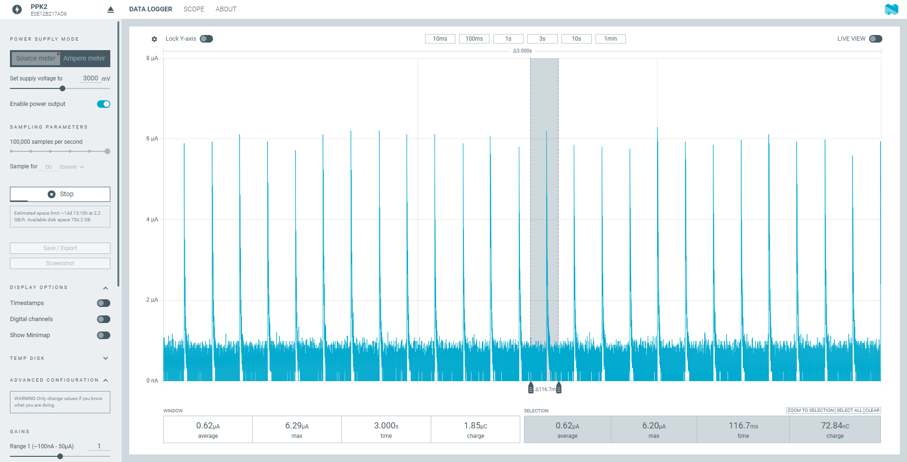
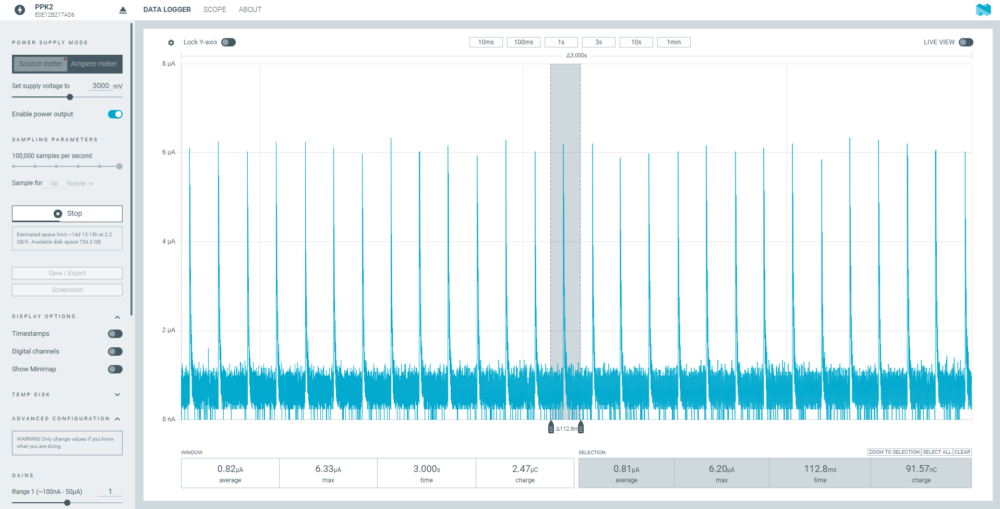
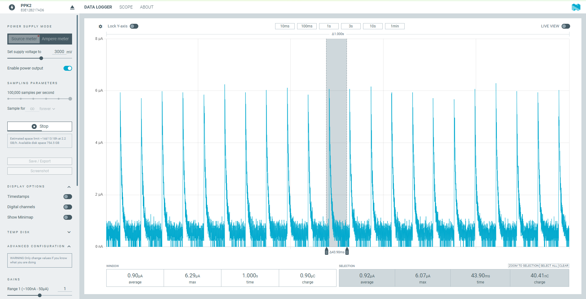
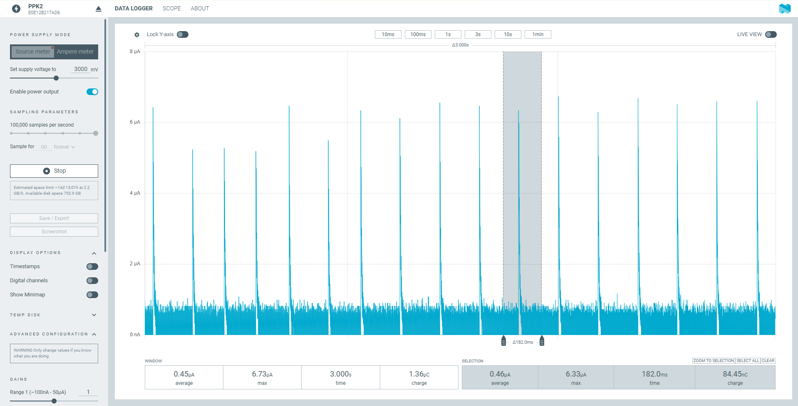
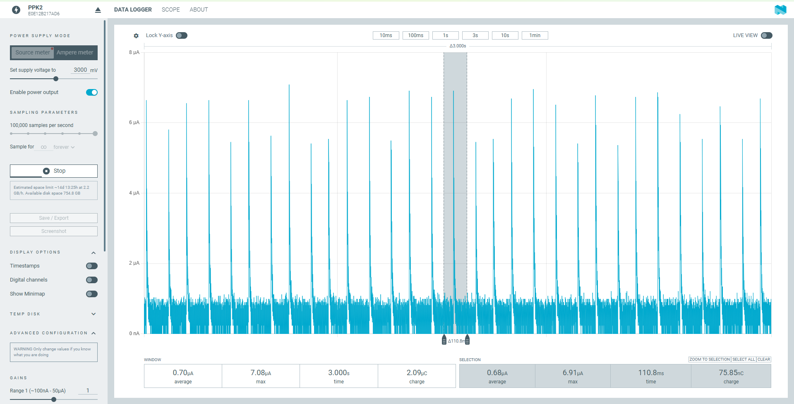
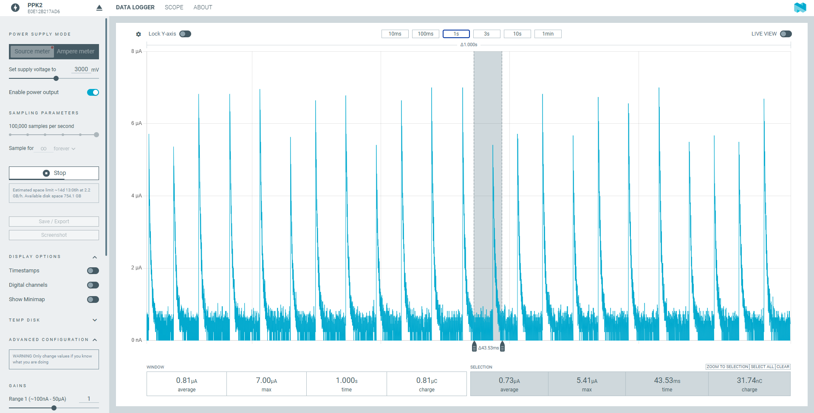
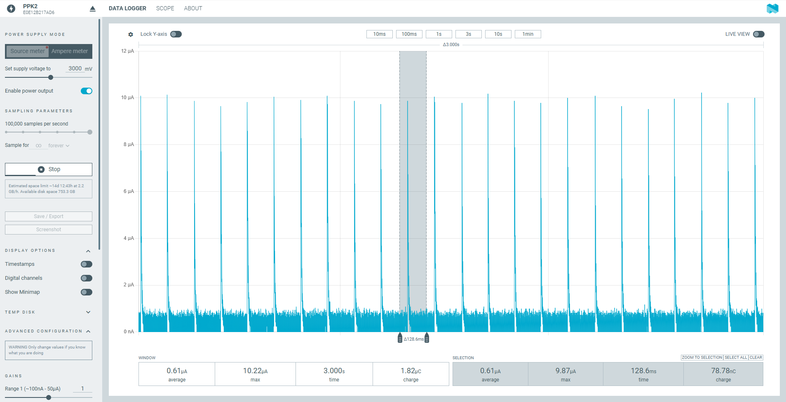
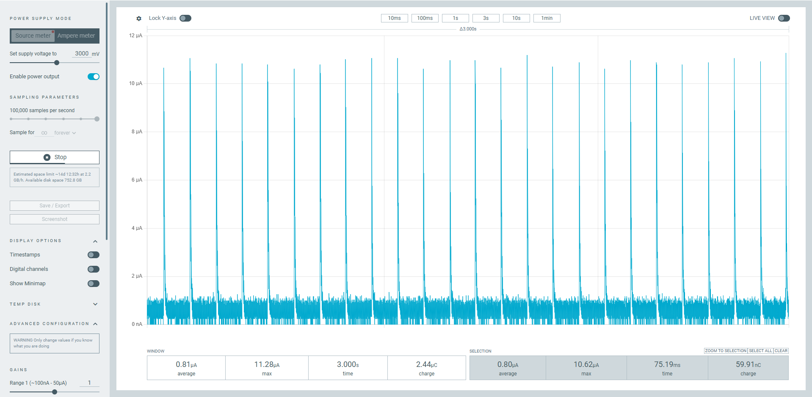
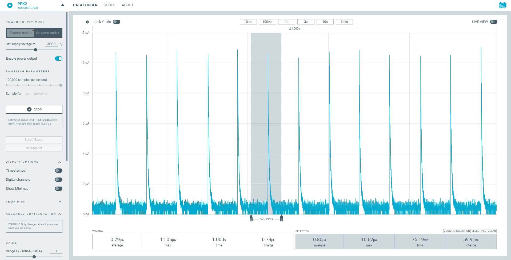

# system_off — 上电进入 System OFF 的 sample

用于验证 nRF54L15 DK、nRF54LM20 DK 和 nRF54LS05 DK 在启动之后都进入 System OFF,并测量不同唤醒源、不同 RAM 保持配置下的 System OFF 电流。

- SDK:nRF Connect SDK v3.4.1(sysbuild)
- 目标板:`nrf54l15dk/nrf54l15/cpuapp`、`nrf54lm20dk/nrf54lm20a/cpuapp`、`nrf54lm20dk/nrf54lm20b/cpuapp`、`nrf54ls05dk/nrf54ls05a/cpuapp`、`nrf54ls05dk/nrf54ls05b/cpuapp`
- 低频时钟:一直使用 LFXO

## 应用做了什么

`main()` 按顺序:

1. 打印 `system_off sample started`。
2. `report_boot()`:打印 reset cause(只打印,不参与判断);如果开了 `CONFIG_APP_USE_RETAINED_MEM`,校验保持 RAM 里的数据、`boots` 和 `off_count` 加 1 并写回。
3. `prepare_wakeup()`:按 Kconfig 开启唤醒源。
   - `CONFIG_APP_GRTC_WAKEUP_ENABLE`:`z_nrf_grtc_wakeup_prepare()`,`CONFIG_APP_GRTC_WAKEUP_SECONDS` 秒后唤醒(默认 10 s)。
   - `CONFIG_APP_GPIO_WAKEUP_ENABLE`:`sw0` 配成输入、电平触发中断;先等按键释放,避免一进 System OFF 就被唤醒;超过 `CONFIG_APP_GPIO_RELEASE_TIMEOUT_MS`(默认 5000 ms)还按着就打印 `LOG_WRN` 并放弃 sw0 唤醒,不会一直卡住。
   - GRTC 最后才 arm,`z_nrf_grtc_wakeup_prepare()` 之后直接进入 System OFF,不再打印日志。
4. 进入 System OFF:`sys_poweroff()`;调用前先清掉 `MEMCONF POWER[1].RET` 里 sys_poweroff() 没处理的块(ICACHE、CRACEN、USBHS)的保持。

## 配置

三个维度:

| 维度 | 选项 | 怎么选 |
|---|---|---|
| 日志 | 开(默认)/ 关(release) | release 加 `-DFILE_SUFFIX=release`,使用 `prj_release.conf` 和 `app_release.overlay`(`uart20` 禁用,日志、串口、HWINFO 关闭) |
| 模式 | `pin` / `grtc` / `ret` | 见下表 |
| 板 | L15 / LM20A / LM20B / LS05A / LS05B | `west build -b ...` 或 dev shell 的 `setup` |

| 模式 | 唤醒 | RAM | 编译选项 | 板 |
|---|---|---|---|---|
| `pin` | sw0 | 进入前关闭 GRTC 和低频时钟 | `-S pinwake`,等价于 `-DCONFIG_APP_GPIO_WAKEUP_ENABLE=y` | 全部 |
| `grtc` | GRTC,10 s | 清 POWER[1] 保持 | `-S grtcwake`,等价于 `-DCONFIG_APP_GRTC_WAKEUP_ENABLE=y` | 全部 |
| `ret` | sw0 | 保持 4 KB,并关闭 GRTC 和低频时钟 | `-S pinwake -S retram`,等价于 `-DCONFIG_APP_GPIO_WAKEUP_ENABLE=y -DCONFIG_APP_USE_RETAINED_MEM=y -DEXTRA_DTC_OVERLAY_FILE=snippets/retram/<soc>.overlay`(`retram` 按板自动选 overlay) | 5 块都能编译 |


`prj.conf` 和 `prj_release.conf` 都开启 `CONFIG_PM_DEVICE`、`CONFIG_PM_DEVICE_RUNTIME`、`CONFIG_POWEROFF`,并把已弃用的 `CONFIG_NRF_PLATFORM_LUMOS` 关掉。release 另外关闭 `CONFIG_UART_CONSOLE`。

用 snippet 选模式:`west build --sysbuild -b <board> -S pinwake|grtcwake|retram -- -DSNIPPET_ROOT=<本目录>`(定义在 `snippets/`)。不加 snippet 的默认配置:没有唤醒源(只有复位或断电再上电才能重新启动)、不保持 RAM、进入前关闭 GRTC 和低频时钟。snippet 可以组合,例如 `-S pinwake -S retram`。sysbuild 要显式给 `SNIPPET_ROOT`,否则 sysbuild 找不到本地 snippet。snippet 会应用到所有镜像。

### Kconfig

| 符号 | 说明 |
|---|---|
| `APP_USE_RETAINED_MEM` | 依赖设备树有 `retainedmemdevice` alias(来自 `snippets/retram/<soc>.overlay`);自动 select `RETAINED_MEM` 和 `CRC` |
| `APP_GRTC_WAKEUP_ENABLE`、`APP_GRTC_WAKEUP_SECONDS` | GRTC 唤醒和唤醒时间(默认 10 s) |
| `APP_GPIO_WAKEUP_ENABLE` | 依赖 `sw0` alias;自动 select `GPIO`;默认关,`pinwake` snippet 打开 |
| `APP_GPIO_RELEASE_TIMEOUT_MS` | 等 sw0 释放的超时(默认 5000 ms);超时后不装 sw0 唤醒,直接进 System OFF |
| `APP_SYS_CLOCK_DISABLE` | 进入 System OFF 前调用 `sys_clock_disable()` 关 GRTC 和低频时钟;默认 `y`,不能和 `APP_GRTC_WAKEUP_ENABLE` 同时开 |

注意:开日志时,`sys_clock_disable()` 之前必须先让 UART 运行时 PM 的异步挂起工作跑完(`main.c` 里 `k_msleep(100)`)。否则系统时钟停了以后调度器在 `sys_clock_elapsed()` 里反复读已停止的 GRTC 计数器,CPU 全速空转。

每次进入 System OFF 前都会清 `MEMCONF POWER[1].RET` 里 sys_poweroff() 没处理的位(清 ICACHE 之前先 `sys_cache_instr_disable()`,数据手册要求关 ICACHE 块时 cache 必须是禁用的)。`POWER[1].RET` 的 bit n 对应块 32+n,复位值全是 1(保持),按芯片:

| 位 | 块 | nRF54L15 / L10 / L05 | nRF54LM20A/B | nRF54LS05A/B |
|---|---|---|---|---|
| bit0 | 32 | VPR 休眠 RAM(sys_poweroff() 已清) | 同左 | 同左 |
| bit1 | 33 | ICACHE tag + data | ICACHE | ICACHE |
| bit2 | 34 | CRACEN PKE code RAM | USBHS RAM | 文档未列出 |
| bit3 | 35 | CRACEN KeyRAM | 文档未列出 | 文档未列出 |

### 设备树

overlay 分三层:

- `boards/dk_common.overlay`:所有 DK 通用。删除 LED、PWM LED 和相关 alias,`pwm20` 禁用,`uart20` 开机挂起。默认删除 `buttons`(所有按键)节点和 `sw0` alias,`pinwake` snippet 按芯片(`snippets/pinwake/<soc>.overlay`)重建 `buttons` 里的 `button0` 和 `sw0 = &button0` 作为 GPIO 唤醒脚;`button0` 的引脚在 L15 和 LS05 是 P1.13,在 LM20 是 P1.26(`pinwake.conf` 同时打开 `APP_GPIO_WAKEUP_ENABLE`,Kconfig 依赖 `sw0` alias 可用)。
- `boards/dk_l15_lm20_common.overlay`:nRF54L15 和 nRF54LM20 专用。删除 `button1~3`、板载 SPI flash(`mx25r64`),`spi00` 禁用,NFC 引脚转为 GPIO。nRF54LS05 没有这些节点,所以不能用这一层。
- `boards/<board>.overlay`:`uart20` 只保留 TX 引脚(L15 是 P1.04,LM20 是 P1.16,LS05 是 P1.10)。LM20 的 a/b 共用 `nrf54lm20dk_common.overlay`,LS05 的 a/b 共用 `nrf54ls05dk_common.overlay`。

4 KB 保持 RAM **不在默认构建里**(L15 的位置和 `zephyr/samples/boards/nordic/system_off` 不同:上游放在 `0x2002e000` 并把后面 68 KB 留给 FLPR,这里不用 FLPR,放在 256 KB 的末尾),这样默认构建里 cpuapp 拿到全部 RAM(L15 256 KB,LS05A 64 KB,LS05B 96 KB,LM20 511 KB)。保持区域放在单独的 `snippets/retram/<soc>.overlay` 里,`retram` snippet 按板把它加进去(dev shell 的 `ret` 会自动用):

| 文件 | 板 | 保持区域 | cpuapp SRAM |
|---|---|---|---|
| `snippets/retram/nrf54l15.overlay` | L15 | `0x2003f000` | 256 KB 缩到 252 KB |
| `snippets/retram/nrf54lm20.overlay` | LM20A / LM20B | `0x2007ec00` | 缩到 507 KB |
| `snippets/retram/nrf54ls05a.overlay` | LS05A(RAM 64 KB) | `0x2000f000` | 64 KB 缩到 60 KB |
| `snippets/retram/nrf54ls05b.overlay` | LS05B(RAM 96 KB) | `0x20017000` | 96 KB 缩到 92 KB |

`boards/<board>_release.overlay` 在上面基础上再 include `app_release.overlay`,禁用 `uart20`。

### RAM 保持

`sys_poweroff()` 先关闭所有 RAM 的保持,再根据 `retained_mem` 驱动恢复设备树里 `zephyr,retained-ram` 区域的保持。所以:

- 不开 `APP_USE_RETAINED_MEM`:不保持任何 RAM(规格书的 0 KB 条件)。
- 开 `APP_USE_RETAINED_MEM`:保持这 4 KB,`src/retained.c` 用 CRC 校验。冷上电时 RAM 内容无效,会被重置,日志里显示 `INVALID`;从 System OFF 唤醒后显示 `valid`,`boots` 递增。

nRF54L15 DK 上 `pin` 模式(sw0 唤醒)的 PPK2 截图:Source 3.0 V,100 kHz,3 s 窗口平均 0.62 µA。



nRF54L15 DK 上 `grtc` 模式(GRTC 唤醒)的 PPK2 截图:Source 3.0 V,100 kHz,3 s 窗口平均 0.82 µA。



nRF54L15 DK 上 `ret` 模式(保持 4 KB retained_mem,L15 上实际保持一个 32 KB RAM 段)的 PPK2 截图:Source 3.0 V,100 kHz,1 s 窗口平均 0.90 µA。



nRF54LS05B DK 上 `pin` 模式(sw0 唤醒)的 PPK2 截图:Source 3.0 V,100 kHz,3 s 窗口平均 0.45 µA。



nRF54LS05B DK 上 `grtc` 模式(GRTC 10 s 唤醒)的 PPK2 截图:Source 3.0 V,100 kHz,3 s 窗口平均 0.70 µA。



nRF54LS05B DK 上 `ret` 模式(sw0 唤醒,保持 4 KB retained_mem,在第三个 32 KB 段里)的 PPK2 截图:Source 3.0 V,100 kHz,1 s 窗口平均 0.81 µA。



nRF54LM20B DK 上 `pin` 模式(sw0 唤醒)的 PPK2 截图:Source 3.0 V,100 kHz,3 s 窗口平均 0.61 µA。



nRF54LM20B DK 上 `grtc` 模式(GRTC 10 s 唤醒)的 PPK2 截图:Source 3.0 V,100 kHz,3 s 窗口平均 0.81 µA。



nRF54LM20B DK 上 `ret` 模式(保持 4 KB retained_mem)的 PPK2 截图:Source 3.0 V,100 kHz,1 s 窗口平均 0.79 µA。



**LS05B 的第三段 RAM:** LS05B 有 96 KB(3 段 × 32 KB),但 nrfx 的 RAM 表里 nRF54LS05 只有 2 段,`sys_poweroff()` 只清了 `POWER[0].RET` 的 bit 0、1(进入前读到 `0xffffffff`,关保持后 `0xfffffffc`),第三段(`0x20010000–0x20017FFF`)的保持一直开着。LS05A 只有 64 KB(2 段),不受影响。`main.c` 的 `extra_ram_off()` 里对 LS05B 在不开 `APP_USE_RETAINED_MEM` 时再清 bit 2。

`src/retained.c`、`src/retained.h` 从原始例子拷贝,保留原有的 Apache-2.0 许可头。

## 规格书中的 System OFF 电流

条件:VDD = 3 V,25 °C,DC/DC,参考电路。System OFF 下 "RAM" 指保持的 RAM 量。

| 芯片 | 符号 | 条件 | 典型值 |
|---|---|---|---|
| nRF54L15 / L10 / L05 | IOFF0 | System OFF,引脚唤醒,保持 0 KB RAM | 0.7 µA |
| nRF54L15 / L10 / L05 | IOFF1 | System OFF,引脚 + GRTC(LFXO)唤醒,保持 0 KB RAM | 0.9 µA |
| nRF54LM20A / B | IOFF0 | System OFF,引脚唤醒,保持 0 KB RAM | 0.7 µA |
| nRF54LM20A / B | IOFF1 | System OFF,引脚 + GRTC(LFXO)唤醒,保持 0 KB RAM | 1.0 µA |
| nRF54LS05A / B | IOFF0 | System OFF,引脚唤醒,保持 0 KB RAM | 0.6 µA(规格书标注为估计值) |
| nRF54LS05A / B | IOFF1 | System OFF,引脚 + GRTC(LFXO)唤醒,保持 0 KB RAM | 0.7 µA(规格书标注为估计值) |

- 勘误 [37](L15 Engineering B、Revision 1、Revision 2):引脚复位或上电后太快进入 System OFF,电流会偏高。NCS v3.4.1 的 `SystemInit()` 已经实现规避,用 NCS 编译不需要手动加。

## 编译

```
west build -b nrf54l15dk/nrf54l15/cpuapp --sysbuild -S grtcwake -- -DSNIPPET_ROOT=<本目录>
west build -b nrf54lm20dk/nrf54lm20a/cpuapp --sysbuild -S pinwake -S retram -- -DSNIPPET_ROOT=<本目录>
west build -b nrf54lm20dk/nrf54lm20b/cpuapp --sysbuild -S pinwake -S retram -- -DSNIPPET_ROOT=<本目录> -DFILE_SUFFIX=release
west build -b nrf54ls05dk/nrf54ls05b/cpuapp --sysbuild -- -DFILE_SUFFIX=release
```

## 开发 shell

双击 `dev.cmd`(或 `. .\dev.ps1`)打开 PowerShell,提供 `setup`、`build`、`rebuild`、`flash`、`recover`、`clean`:

```
setup                                  # 检查 NCS,再选板 / 模式 / 日志
setup -Board lm20a -Mode grtc -Log off # 也可以直接给参数
rebuild                                # west build -p --sysbuild,输出到 build\<板>_<模式>[_log]
flash                                  # 烧录所选配置(不重新编译,不 mass erase)
recover                                # 恢复 DK(nrfutil device recover),会先确认
```

`-Board`:`l15`、`lm20a`、`lm20b`、`ls05a`、`ls05b`;`-Mode`:`pin`、`grtc`、`ret`;`-Log`:`on`、`off`。

`recover` 会擦除芯片上的全部 flash 和 UICR 并解除访问口保护,固件和数据都会丢失,用在板子无法烧录或连接的时候;执行前要输入 `y` 确认(`-Force` 跳过确认)。只有一个 J-Link 设备时自动选它,有多个时让你输入序列号(也可以用 `-DevId <序列号>` 指定)。恢复后用 `flash` 重新烧录。

## 测试(twister)

`sample.yaml` 里有 6 个场景,命名 `sample.system_off.log.<pin|grtc|ret>`(带日志)和 `sample.system_off.<pin|grtc|ret>`(release),用 `required_snippets` 选模式,五块板都只做构建。twister 要加 `--extra-args SNIPPET_ROOT=<本目录>`,原因同上。

```
west twister -T . -p nrf54l15dk/nrf54l15/cpuapp --extra-args SNIPPET_ROOT=<本目录> --ninja --short-build-path
```

**Windows 上建议加 `--ninja --short-build-path` 以减少路径长度。** twister 的构建目录是 `<输出目录>\<板>\<工具链>\<工程相对路径>\<场景名>`

`--short-build-path` 在 `<输出目录>\twister_links\` 下建目录联接指向真正的构建目录,让 CMake 和 Ninja 用短路径;它要求同时加 `--ninja`。不想加这两个选项时,可以用 `--outdir C:\bd` 指定很短的输出目录。

板上验证(nRF54L15 DK,NCS v3.4.1):`log`+`grtc`+`ret`+LFXO,唤醒后保持 RAM 校验 `valid`,`boots` 递增。

已通过 dev shell 编译验证(`rebuild`):5 块板 × `pin`/`grtc`/`ret` × 日志开/关,共 30 个配置全部构建成功,`.config` 里的唤醒源、RAM 保持、关系统时钟选项和模式一致。twister 在 LM20B 上 6 个场景全部构建成功(只构建不运行)。其余 4 块板的 twister 没有跑过,所有配置都没有在板上实测(L15 `log`+`grtc`+`ret` 除外,见上)。

## 目录

| 路径 | 内容 |
|---|---|
| `CMakeLists.txt` | 工程定义;`APP_USE_RETAINED_MEM` 时加入 `src/retained.c` |
| `Kconfig` | 唤醒源、RAM 保持、关系统时钟开关 |
| `prj.conf` | 默认配置(日志开) |
| `prj_release.conf`、`app_release.overlay` | `FILE_SUFFIX=release`:日志、串口、HWINFO 关,`uart20` 禁用 |
| `dev.cmd`、`dev.ps1` | 开发 shell,见下 |
| `sample.yaml` | twister 场景(6 个)和板型列表 |
| `boards/` | 设备树 overlay,分层见上 |
| `snippets/` | `pinwake`、`grtcwake`、`retram` 三个 snippet(各带自己的 conf / overlay) |
| `src/main.c` | 应用:打印、唤醒源、进入 System OFF |
| `src/retained.c`、`src/retained.h` | 保持 RAM 的 CRC 校验(原始例子拷贝) |
| `.gitignore` | 忽略 `build*/` |
